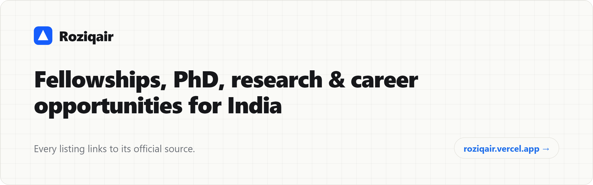

<!-- Generated from the Roziqair catalog. Do not edit by hand: open an issue instead (see CONTRIBUTING.md). -->

# not-awesome-indian-opportunities

**Fellowships, research internships, funded Master's, PhD positions and tech jobs for Indian students. Every listing links to its official source.**

Not awesome, just accurate: no reposts, no agencies, no paid listings.

### 👉 [Open the live app: roziqair.vercel.app](https://roziqair.vercel.app)

Search and filter, save opportunities, back up your list and add deadlines to your calendar.

_Updated 2026-10-26 · 1,130 listings._

## Browse

| Listing | Count | What it is |
|---|---|---|
| [Fellowships](listings/programmes/fellowships.md) | 50 | Research, PhD and early-career fellowships. |
| [Funded Master's & study scholarships](listings/programmes/funded-masters.md) | 73 | Scholarships and funded places for Master's and other degree study. |
| [Research internships](listings/programmes/research-internships.md) | 39 | Summer and visiting research internships at universities and labs. |
| [Graduate programmes](listings/programmes/graduate-programmes.md) | 1 | Structured graduate and early-career programmes run by employers. |
| [Tech jobs & internships](listings/jobs/tech-jobs-india.md) | 525 | India-applicable roles from employers' own career boards. |
| [PhD, postdoc & faculty](listings/academic/phd-postdoc-faculty.md) | 433 | Community-shared academic roles (not verified: check the posting). |
| [Hackathons & events](listings/hackathons-and-events.md) | 9 | Hackathons, summits and schools open to Indian students. |

## Closing in the next 30 days

| Deadline | Opportunity | Organisation | Type | Links |
|---|---|---|---|---|
| 2026-10-27 | Visiting Students Research Engagement Programme | Indian Institute of Technology Gandhinagar | Internship | [Official ↗](<https://iitgn.ac.in/admissions/visiting-students-research-engagement-programme>) · [Details](<https://roziqair.vercel.app/p/iit-gandhinagar-vsrep>) |
| 2026-10-30 | NVIDIA Graduate Fellowship Program | NVIDIA | Fellowship | [Official ↗](<https://blogs.nvidia.com/?p=98499>) · [Details](<https://roziqair.vercel.app/p/nvidia-graduate-fellowship>) |
| 2026-10-30 | University Summer Courses offered in Germany for Foreign Students and Graduates (HSK) | DAAD (German Academic Exchange Service) | Fellowship | [Official ↗](<https://www2.daad.de/deutschland/stipendium/datenbank/en/21148-scholarship-database/?status=1&origin=&subjectGrps=&daad=1&intention=&q=&page=1&detail=50035295>) · [Details](<https://roziqair.vercel.app/p/daad-university-summer-courses>) |
| 2026-10-30 | Wanted the best - Scholarships 2026-2027 | Sapienza University of Rome | Master's | [Official ↗](<https://www.uniroma1.it/en/pagina/scholarships-meritorious-students-italian-and-international-universities>) · [Details](<https://roziqair.vercel.app/p/sapienza-wanted-the-best-scholarships>) |
| 2026-10-31 | Build for Bharat Fellowship | Bharat Digital | Fellowship | [Official ↗](<https://bharatdigital.org/fellowship>) · [Details](<https://roziqair.vercel.app/p/build-for-bharat-fellowship>) |
| 2026-10-31 | Scholarship for Foreign Students | Honjo International Scholarship Foundation | Master's | [Official ↗](<https://www.hisf.or.jp/en/scholarship/foreigner/>) · [Details](<https://roziqair.vercel.app/p/honjo-international-scholarship>) |
| 2026-11-01 | ACI Foundation Scholarships and Fellowships | ACI Foundation (American Concrete Institute) | Master's | [Official ↗](<https://www.acifoundation.org/scholarships.aspx>) · [Details](<https://roziqair.vercel.app/p/aci-foundation-scholarships>) |
| 2026-11-01 | AI Safety Fellowship | Pivotal Research | Fellowship | [Official ↗](<https://www.pivotal-research.org/fellowship>) · [Details](<https://roziqair.vercel.app/p/pivotal-ai-safety-fellowship>) |
| 2026-11-01 | EPFL Excellence in Engineering (E3) | EPFL | Internship | [Official ↗](<https://eee.epfl.ch/>) · [Details](<https://roziqair.vercel.app/p/epfl-e3-excellence-in-engineering>) |
| 2026-11-01 | Junior Fellows Internship Programme | United Nations University (Office of the Rector, Tokyo) | Internship | [Official ↗](<https://careers.unu.edu/o/junior-fellows-internship-spring2027>) · [Details](<https://roziqair.vercel.app/p/unu-junior-fellows-internship>) |

[See all 128 deadlines in the next 30 days →](listings/closing-soon.md)

## How listings are checked

- **Programmes, hackathons & events (verified):** every value is quoted from the organiser's official page, with the date it was checked.
- **Tech jobs (employer board):** read from the employer's own career board, with the date the posting was last seen.
- **Academic positions (community-shared):** shared by the academic community and not verified by Roziqair: check the posting itself.

## How this repository stays in sync

The files in [`listings/`](listings/README.md) are generated from the Roziqair catalog and replaced on every update, so edits to them are overwritten. To add or fix something, use an issue or a pull request (below); accepted changes reach both the app and this repository on the next update.

## Contribute

Found an opportunity, a mistake or a suspicious scheme? Open an issue with one of the [issue forms](../../issues/new/choose), or send a pull request that adds one row to [`submissions/submissions.csv`](submissions/submissions.csv). Every submission is checked against the official page before it is listed. See [CONTRIBUTING.md](CONTRIBUTING.md) and the [code of conduct](CODE_OF_CONDUCT.md).

## Stay safe

No real opportunity asks you to pay for a guaranteed seat, offer letter or certificate. Read the common warning signs in [`safety/scam-patterns.md`](safety/scam-patterns.md), and the warnings in the app: [roziqair.vercel.app/warnings](https://roziqair.vercel.app/warnings).

## For developers

[`examples/`](examples/) has small, dependency-free scripts that read the public, documented job-board APIs of Greenhouse and Lever, with notes on fetching responsibly. They are teaching examples, not the Roziqair pipeline.

## Licence

The listings and documentation are licensed under [CC BY-NC 4.0](https://creativecommons.org/licenses/by-nc/4.0/) ([`LICENSE`](LICENSE)): share and adapt them for non-commercial use, with credit to Roziqair and a link to this repository. The code in [`examples/`](examples/) is MIT-licensed ([`examples/LICENSE`](examples/LICENSE)). Programme names, logos and the linked pages belong to their organisers.

Deadlines and eligibility change. Always confirm on the official page before you apply or pay anything.
